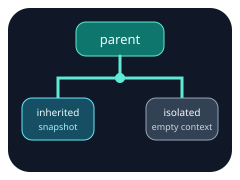

## 🧭 Overview
A dependency-free Python 3.11+ CLI lab that makes <code>contextvars</code> behavior visible. Each asyncio task receives the context snapshot active when it is created.

## ✨ Features
- 🧩 Compare inherited and isolated task contexts.
- 🔁 Observe <code>ContextVar.set()</code> tokens and safe <code>reset()</code>.
- 🧪 See how parent changes affect tasks created later.
- 📦 Print JSON for scripts or teaching material.

## 🎬 Demo
No hosted demo is provided. Run locally to see child tasks inherit request-A or request-B while an isolated task sees the default.

## ⚡ Quick Start
Requires Python 3.11+. No third-party packages are needed.

~~~bash
python contextvars_lab.py
python contextvars_lab.py --json
python -m unittest discover -s tests
~~~

## 🧰 Tech Stack
- Python 3.11+
- <code>asyncio</code>, <code>contextvars</code>, standard library

## 🗂️ Folder Structure
~~~text
python-contextvars-lab/
├── assets/mark.svg
├── tests/test_contextvars_lab.py
├── contextvars_lab.py
├── .gitignore
├── LICENSE
└── README.md
~~~

## 🗺️ Roadmap
- [x] Task creation snapshots
- [x] Isolated task context
- [x] Token reset example
- [ ] Add a context-manager exercise

## 🤝 Contributing
Focused pull requests are welcome. Keep examples deterministic and compatible with Python 3.11+.

## 📄 License
MIT License. See [LICENSE](LICENSE).

